# Introduction

This guide explains how to create, configure, and access a virtual machine (VM) using Linnaeus University's (LNU) Computer Science (CS) cloud infrastructure, which is based on OpenStack.

Before proceeding, ensure that you have been granted permission to create and manage virtual machines on the LNU CS cloud and that you have received valid login credentials.

You can access the OpenStack dashboard [here](https://cumulus.lnu.se/).

<figure>
  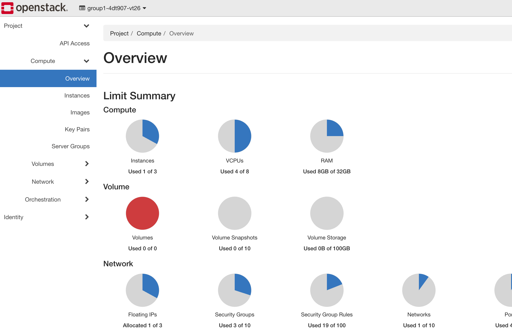
  <figcaption>Figure 1: Overview of the OpenStack dashboard.</figcaption>
</figure>

After logging in, you will be presented with an overview of the available computing resources and their current usage, as illustrated in Figure 1.

## Configuring a virtual network

TODO

## Creating a new instance

This section describes how to create and configure a new VM instance through the OpenStack dashboard.

<figure>
  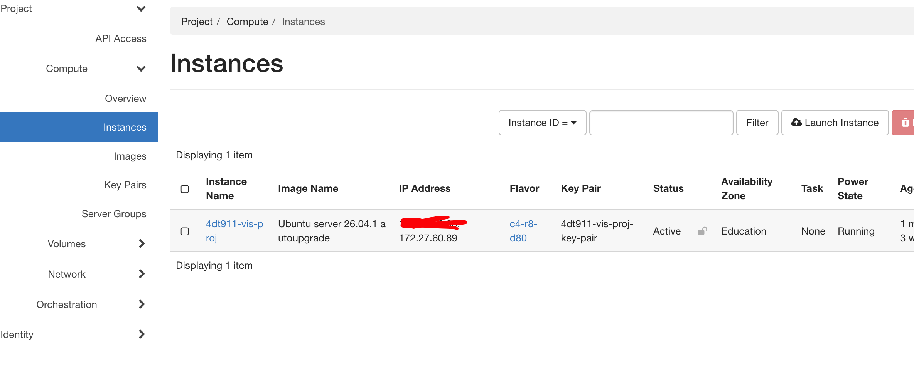
  <figcaption>Figure 2: Overview of existing VM instances.</figcaption>
</figure>

**Step 1: Launch a new instance**

Navigate to the **Instances** tab, which displays the existing VM instances and their current status, as shown in Figure 2.

Click **Launch Instance** to open the instance creation dialog.

<figure>
  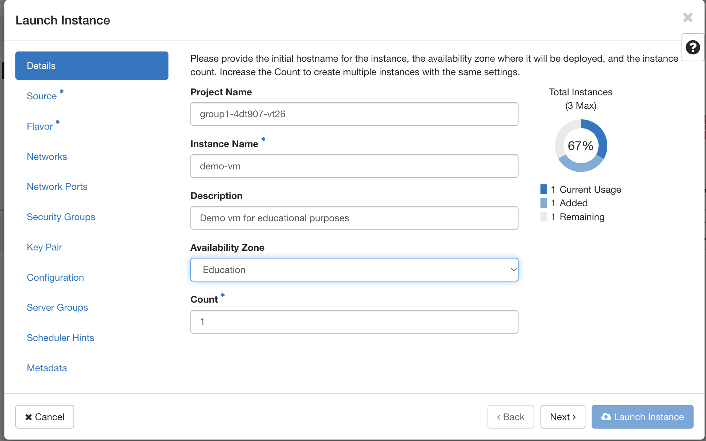
  <figcaption>Figure 3: Configuring the instance details.</figcaption>
</figure>

**Step 2: Configure instance details**

In the **Details** tab, shown in Figure 3, provide the following information:

- **Instance Name:** Enter a descriptive name for the VM.
- **Description:** Optionally, provide a short description of the instance's intended purpose.
- **Availability Zone:** Keep the default value, `Education`.
- **Count:** Set this to `1`, since only one instance will be created.

Once these settings have been configured, proceed to the **Source** tab.

<figure>
  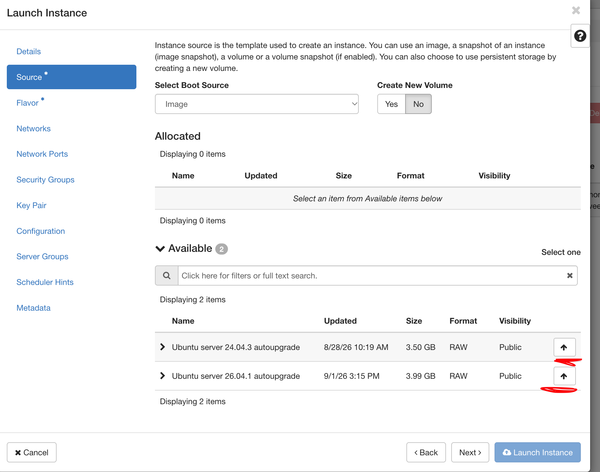
  <figcaption>Figure 4: Available operating system images in the Source tab.</figcaption>
</figure>

<figure>
  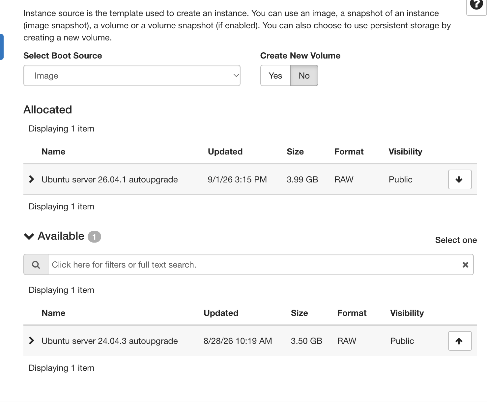
  <figcaption>Figure 5: Selected operating system image moved to the Allocated section.</figcaption>
</figure>

**Step 3: Select an operating system image**

The **Source** tab allows you to select the operating system image that will be installed on the VM.

As illustrated in Figure 4, several images are available, including Ubuntu Server versions `26.04.1` and `24.04.3`.

For this demonstration, we select **Ubuntu Server 26.04.1**.

To select an image, click the corresponding allocation button. The selected image will then appear in the **Allocated** section, as illustrated in Figure 5.

Creating a separate storage volume is optional. For this demonstration, we will use the instance's local disk rather than creating an additional volume.

Once the image has been selected, proceed to the **Flavor** tab.

<figure>
  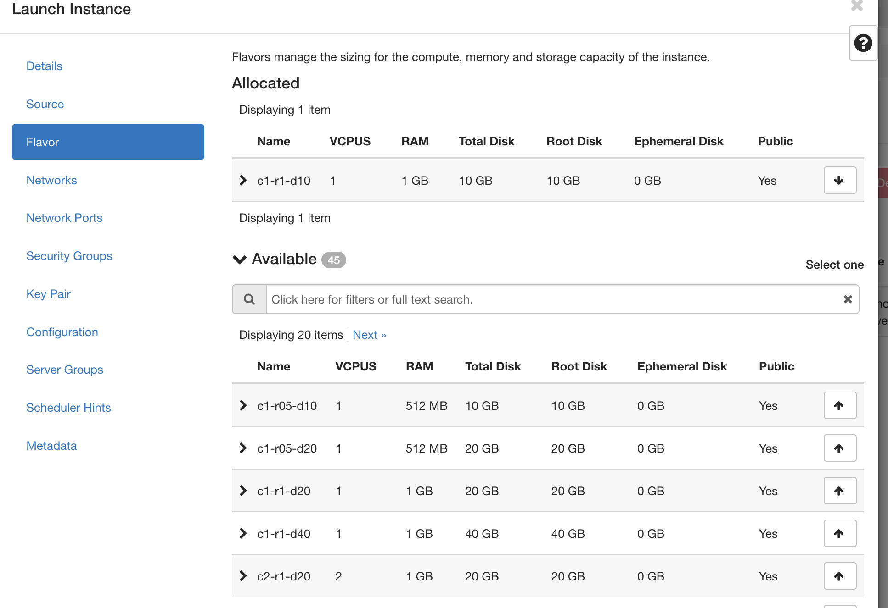
  <figcaption>Figure 6: Available VM flavors and their hardware specifications.</figcaption>
</figure>

**Step 4: Select a flavor**

The **Flavor** tab allows you to select the hardware resources allocated to the VM.

A *flavor* defines the computational resources available to an instance, including the number of virtual CPU cores, memory, and disk storage.

For example, the flavor `c1-r1-d20` provides:

- **CPU:** 1 virtual CPU core (vCPU).
- **RAM:** 1 GB.
- **Disk storage:** 20 GB.

Select a flavor that meets the requirements of your intended workload. Since this is a demonstration, a relatively small flavor is sufficient.

Figure 6 illustrates the available flavors.

After selecting a flavor, proceed to the **Networks** tab.

<figure>
  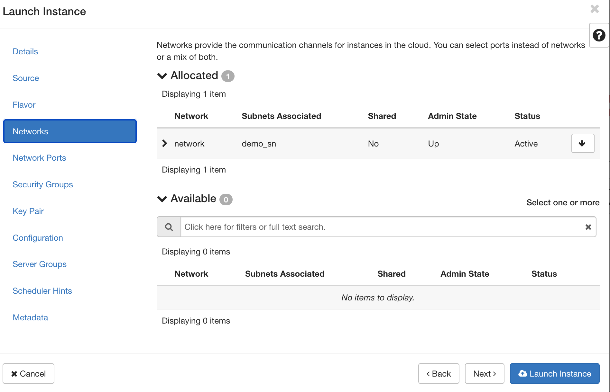
  <figcaption>Figure 7: Network selection during instance creation.</figcaption>
</figure>

**Step 5: Configure networking**

The **Networks** tab allows you to attach the VM to an existing virtual network, as illustrated in Figure 7.

Select the virtual network configured in the previous section.

Attaching a network is necessary to establish network connectivity and subsequently associate a floating IP address with the instance. The floating IP will allow the VM to be accessed remotely through SSH, provided that the necessary network and security configurations are in place.

Once the network has been selected, proceed to the **Security Groups** tab.

<figure>
  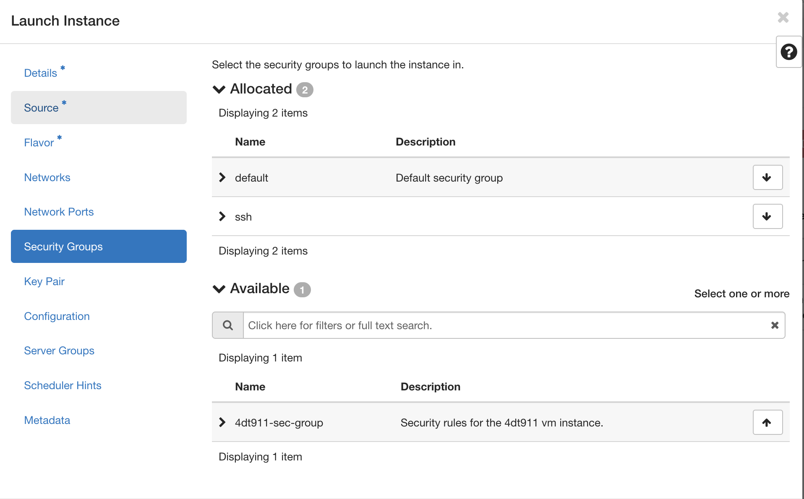
  <figcaption>Figure 8: Configuring security groups for the VM.</figcaption>
</figure>

**Step 6: Configure security groups**

Security groups define the network traffic that is permitted to reach or leave the VM.

As illustrated in Figure 8, ensure that the following security groups are assigned:

- **default:** The default security group associated with the instance.
- **ssh:** A security group that permits incoming SSH connections.

The SSH security group is required to access the VM remotely. Ensure that its rules allow TCP traffic on port `22` from the appropriate source addresses.

After configuring the security groups, proceed to the **Key Pair** tab.

<figure>
  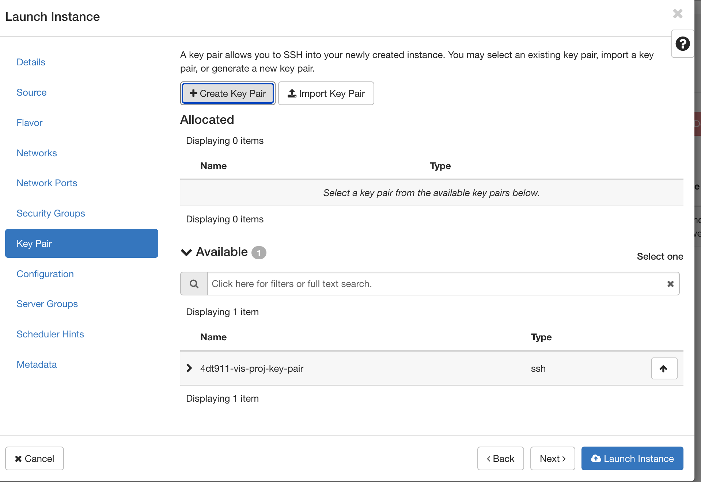
  <figcaption>Figure 9: Key pair selection during instance creation.</figcaption>
</figure>

<figure>
  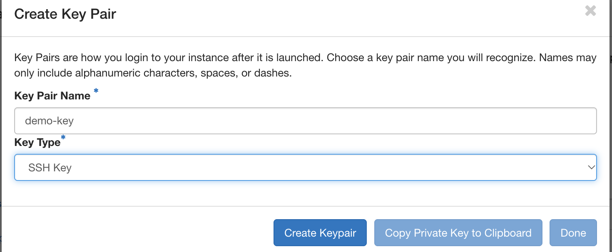
  <figcaption>Figure 10: Creating a new SSH key pair named demo.</figcaption>
</figure>

<figure>
  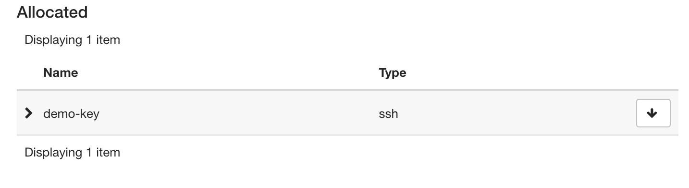
  <figcaption>Figure 11: Newly created SSH key pair added to the Allocated section.</figcaption>
</figure>

**Step 7: Configure SSH authentication**

To securely access the VM through SSH, you must assign an SSH key pair.

As illustrated in Figure 9, you can either select an existing key pair or create a new one.

For this demonstration, we create a new key pair named `demo`:

1. Click **Create Key Pair**.
2. Enter `demo-key` as the key pair name.
3. Ensure that the key type is set to **SSH Key**.
4. Create the key pair and securely save the downloaded private key.

The key pair creation dialog is illustrated in Figure 10, while Figure 11 shows the newly created key pair in the **Allocated** section.

**Important:** Store the private key in a secure location, such as your local `.ssh/` directory if you are using mac. The private key is required to authenticate when connecting to the VM and should never be shared or committed to a Git repository.

**Step 8: Launch the instance**

Once all settings have been configured, click **Launch Instance** to initiate VM creation.

OpenStack will now provision the VM using the selected operating system image, hardware flavor, network, security groups, and SSH key pair.

## Assigning a floating IP address

After launching the instance, you must associate a floating IP address to enable remote access through SSH.

<figure>
  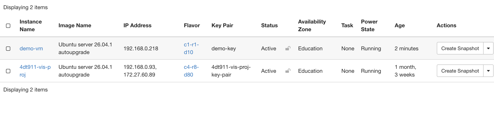
  <figcaption>Figure 12: Instances overview after creating demo-vm.</figcaption>
</figure>

<figure>
  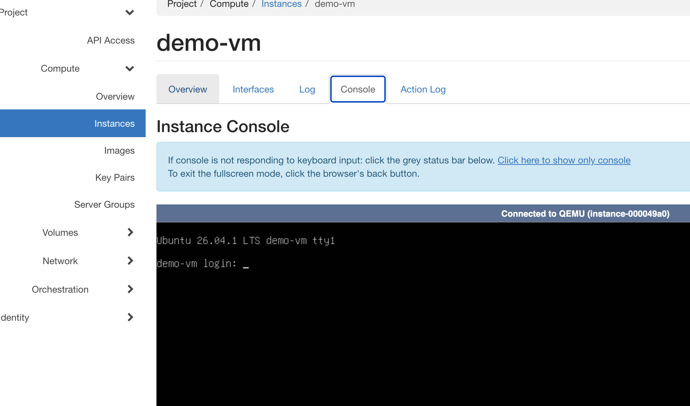
  <figcaption>Figure 13: Console output from the running demo-vm instance.</figcaption>
</figure>

**Step 1: Verify that the instance is running**

Return to the **Instances** tab.

The newly created VM, `demo-vm`, should now appear in the instance list, as shown in Figure 12.

During provisioning, the instance may temporarily display a building status. Once initialization is complete, the **Status** column should display `Active`.

You can also inspect the instance's console output:

1. Click `demo-vm` in the **Instance Name** column.
2. Navigate to the **Console** tab.
3. Verify that the operating system has booted successfully.

Figure 13 illustrates an example of a successfully booted VM console displaying a login prompt.

<figure>
  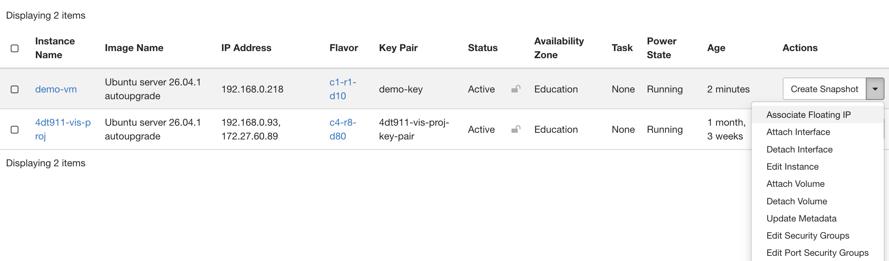
  <figcaption>Figure 14: Selecting Associate Floating IP from the instance actions menu.</figcaption>
</figure>

**Step 2: Open the floating IP configuration**

Locate `demo-vm` in the instance list.

Open the actions dropdown menu and select **Associate Floating IP**, as illustrated in Figure 14.

<figure>
  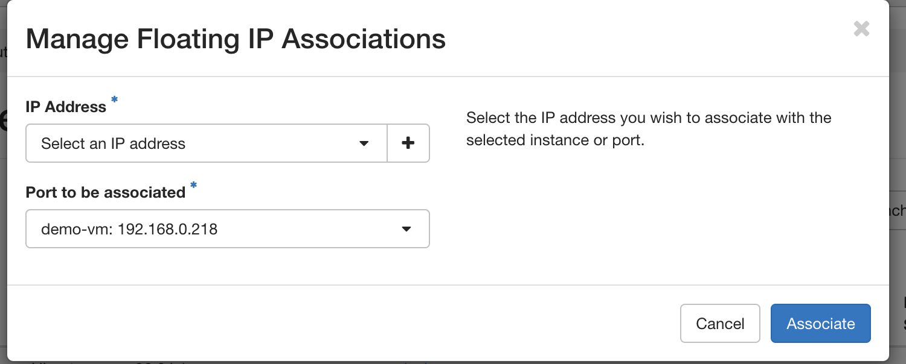
  <figcaption>Figure 15: Floating IP association dialog.</figcaption>
</figure>

**Step 3: Allocate a new floating IP address**

The floating IP association dialog will now appear, as shown in Figure 15.

If no floating IP address is available, click the **plus (+)** button to allocate a new address.

<figure>
  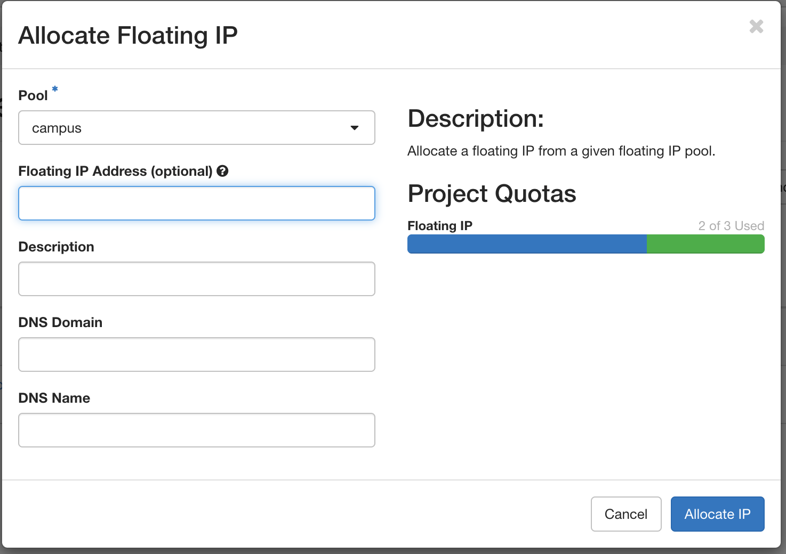
  <figcaption>Figure 16: Allocating a floating IP address from the campus IP pool.</figcaption>
</figure>

**Step 4: Select the IP address pool**

In the allocation dialog, illustrated in Figure 16, ensure that the floating IP address is allocated from the **campus** pool.

No additional configuration is required for this demonstration.

Click **Allocate IP** to request a new address.

Once allocated, return to the association dialog and select the new address from the **Select an IP Address** dropdown menu. Complete the association to attach the address to the VM.

<figure>
  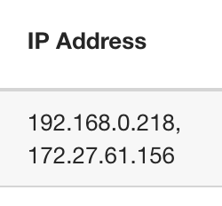
  <figcaption>Figure 17: Instance overview showing the newly associated floating IP address.</figcaption>
</figure>

**Step 5: Verify the floating IP association**

After completing the association, return to the **Instances** tab.

As illustrated in Figure 17, the **IP Address** column should now display two addresses for `demo-vm`:

- The private IP address assigned through the virtual network.
- The floating IP address assigned from the campus pool.

The floating IP address will be used to connect to the instance remotely.

## Accessing the VM through SSH

With the VM running and a floating IP address assigned, we can now connect to it remotely using SSH.

Open a terminal on your local computer and execute the following command:

```bash
ssh -i <PRIVATE_KEY> ubuntu@<FLOATING_IP>
```

Replace the placeholders with the appropriate values:

- `<PRIVATE_KEY>` – The path to the private SSH key associated with the VM.
- `<FLOATING_IP>` – The floating IP address assigned to the instance.

For reference, the following command was used to connect to the VM created in this demonstration:

```bash
ssh -i ~/.ssh/demo-key.pem ubuntu@172.27.61.156
```

Ensure that your private key has appropriate file permissions. On Linux and macOS, these can be configured using:

```bash
chmod 600 ~/.ssh/demo-key.pem
```

If prompted to verify the server's host key during the first connection, confirm that its fingerprint matches the expected server before accepting it.

**Note:** Access to the floating IP may require an active connection to the university network or VPN, depending on the network configuration.

<figure>
  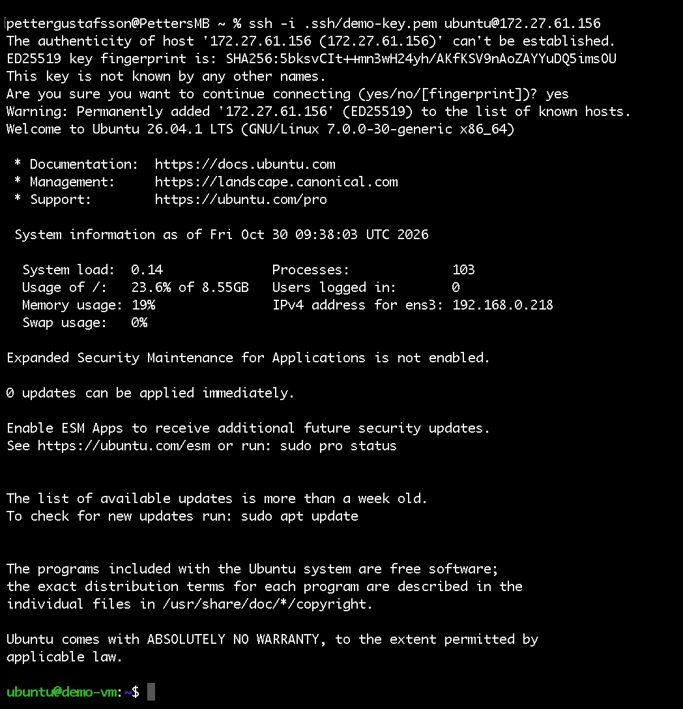
  <figcaption>Figure 18: Successful SSH connection to the Ubuntu Server instance.</figcaption>
</figure>

If the connection succeeds, you should be presented with an Ubuntu terminal similar to the one shown in Figure 18.

You are now connected to the VM and can begin installing software, configuring services, and deploying applications as needed.